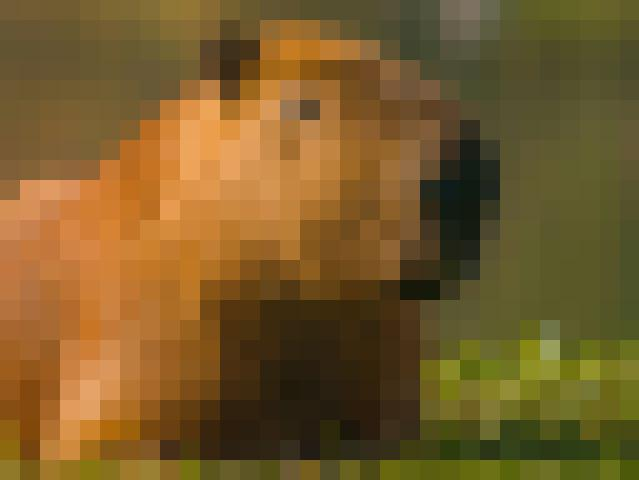

# Image Pixelation — Single-Threaded & Multi-Threaded Processing

A Java desktop application that demonstrates **single-threaded and multi-threaded image processing** using RGB color averaging and progressive visualization.

Developed as an assignment for the **Advanced Software Paradigms** course.

## 1. Project Overview

The application takes a JPG image and applies a pixelation effect by dividing it into square blocks.

For each block, the program:

1. Calculates the average Red, Green, and Blue (RGB) values of its pixels.
2. Creates a new color using these averages.
3. Replaces all pixels in the block with the calculated average color.
4. Gradually displays the processed blocks in a graphical window.

The application supports two processing modes:

- **S — Single-threaded:** Processes image blocks sequentially, from left to right and top to bottom.
- **M — Multi-threaded:** Divides the image into regions and processes them concurrently using multiple CPU threads.

The final processed image is automatically saved as `result.jpg`.

## 2. Technologies Used

| Technology | Purpose |
|---|---|
| Java 17 | Main programming language |
| Java Swing | Graphical interface and visualization |
| BufferedImage | Image pixel manipulation |
| ImageIO | Reading and saving JPG files |
| ExecutorService | Managing parallel worker threads |
| SwingWorker | Background processing |
| ArrayBlockingQueue | Thread-safe communication and bounded buffering |
| Swing Timer | Progressive graphical updates |

The project uses only the **Java Standard Library**, so no external dependencies are required.

## 3. Project Structure

```text
image-pixelation/
├── src/
│   ├── Main.java
│   ├── ImageProcessor.java
│   ├── ImageProcessorTest.java
│   ├── ImageWindow.java
│   └── ProcessingMode.java
├── examples/
│   ├── original.jpg
│   └── result.jpg
├── README.md
└── .gitignore
```

### File Responsibilities

| File | Description |
|---|---|
| `Main.java` | Handles command-line arguments, image loading, and application startup |
| `ImageProcessor.java` | Implements RGB averaging and sequential image processing |
| `ImageWindow.java` | Handles visualization, multithreading, progress tracking, and saving |
| `ProcessingMode.java` | Defines the S and M processing modes |
| `ImageProcessorTest.java` | Contains tests for the image-processing algorithm |

## 4. Requirements

- Windows or macOS
- Java Development Kit (JDK) 17 or newer
- A graphical desktop environment
- A JPG image

Check whether Java is installed:

```bash
java -version
javac -version
```

Both commands should display an installed Java version.

## 5. Installation and Compilation

### Step 1 — Clone the repository

```bash
git clone <https://github.com/musanebizade/asp-task4-image-pixelation.git>
cd image-pixelation
```


### Step 2 — Compile the application

Open a terminal in the project's root directory and execute:

```bash
javac -d build src/Main.java src/ProcessingMode.java src/ImageProcessor.java src/ImageWindow.java src/ImageProcessorTest.java
```

This command works with Java 17 or newer on both Windows and macOS.

Compiled files will be stored in the `build/` directory.

## 6. Running the Application

The program accepts three command-line arguments:

```bash
java -cp build Main <filename> <squareSize> <mode>
```

| Argument | Description | Example |
|---|---|---|
| `filename` | Path to the input JPG image | `examples/original.jpg` |
| `squareSize` | Positive integer specifying the block size | `20` |
| `mode` | `S` for single-threaded or `M` for multi-threaded | `M` |

### Single-threaded Mode

```bash
java -cp build Main examples/original.jpg 20 S
```

### Multi-threaded Mode

```bash
java -cp build Main examples/original.jpg 20 M
```

The application opens a graphical window displaying the original image, then progressively applies the averaging effect.

After completion, the processed image is saved as `result.jpg` in the current working directory.

If the image path contains spaces, use quotation marks:

```bash
java -cp build Main "my images/photo.jpg" 20 M
```

## 7. Example Results

The following example demonstrates the image-processing algorithm with a square size of **20 pixels**.

### Original Image


### Processed Image



Smaller square sizes preserve more visual details, while larger square sizes produce a stronger pixelation effect.

## 8. Image Processing Algorithm

The image is divided into blocks of `squareSize × squareSize` pixels.

For each block, the average RGB values are calculated separately:

Average Red = Sum of red values / Number of pixels

Average Green = Sum of green values / Number of pixels

Average Blue = Sum of blue values / Number of pixels

Where `N` is the number of pixels in the current block.

Every pixel in that block is replaced with the calculated average RGB color.

### Handling Incomplete Blocks

Image dimensions are not always divisible by the specified square size.

For example:

- Image width: 103 pixels
- Image height: 77 pixels
- Square size: 20 pixels

In this case, the application creates **24 blocks (6 columns × 4 rows)**, including smaller blocks along the image boundaries.

The algorithm uses `Math.min()` to calculate the boundaries of each block:

```java
int endX = (int) Math.min(
        (long) startX + squareSize,
        image.getWidth()
);

int endY = (int) Math.min(
        (long) startY + squareSize,
        image.getHeight()
);
```

This ensures that:

- No pixels are skipped.
- No out-of-bounds errors occur.
- Incomplete blocks are processed correctly.
- The original image dimensions are preserved.

## 9. Multithreading Implementation

The application uses Java's `ExecutorService` to distribute image processing across multiple threads.

### Single-threaded Processing

In `S` mode, one background worker processes all blocks sequentially.

The order is:

1. Left to right within a row.
2. Top to bottom across the image.

### Multi-threaded Processing

In `M` mode, the image is divided into separate horizontal regions aligned with block boundaries.

Each region is assigned to an independent worker.

The number of workers is determined using:

```java
Runtime.getRuntime().availableProcessors();
```

The number of workers is also limited by the total number of block rows to avoid creating unnecessary threads.

For example, if eight CPU processors are available, the application can use up to eight workers to process separate regions simultaneously.

### Thread Safety

The application uses an `ArrayBlockingQueue` to transfer completed blocks from processing threads to the visualization thread.

The queue has a fixed capacity of 4,096 blocks.

This prevents unlimited accumulation of processed block objects.

When the queue becomes full, processing threads wait until space becomes available.

All Swing interface updates are performed on the Event Dispatch Thread.

This separation keeps the graphical interface responsive while processing continues in the background.

## 10. Progressive Visualization

The application displays the original image before processing starts.

As blocks are processed, their colors are gradually updated.

The GUI displays:

- Processing mode (S or M)
- Number of processing workers
- Progress percentage
- Number of displayed blocks
- Processing duration after completion

A Swing Timer updates the visualization approximately 30 times per second.

### Large Image Support

If an input image is larger than the available screen, the graphical display is automatically resized while preserving the aspect ratio.

However, all pixel averaging calculations are performed on the **original full-resolution image**, not the resized preview.

The saved output also retains the original image dimensions.

## 11. Performance Comparison

The application was tested using both processing modes.

### Measured Results

| Processing Mode | Duration |
|---|---:|
| Single-threaded (S) | 36.23 ms |
| Multi-threaded (M) | 32.76 ms |


### Performance Analysis

The speedup is calculated as:

**Speedup = Single-threaded time / Multi-threaded time**

**Speedup = 36.23 / 32.76 ≈ 1.11x**

The measured multi-threaded execution was approximately **1.11 times faster**, corresponding to a **9.6% reduction in duration**.

The multi-threaded version completed the measured run **3.47 ms faster** than the single-threaded version.


These measurements indicate a small performance improvement from using multiple threads in this particular test.

However, performance depends on factors such as:

- Input image dimensions
- Square size
- Number of available CPU cores
- Thread scheduling and synchronization overhead
- Available system memory

**Measurement note:** The reported processing times include time spent waiting for the bounded visualization queue when it is full. They represent processing-pipeline measurements rather than isolated CPU computation times.

A larger image does not automatically guarantee proportional speedup, and small workloads may benefit less from multithreading.

## 12. Testing

The project includes automated tests in `ImageProcessorTest.java`.

Run the tests using:

```bash
java -cp build ImageProcessorTest
```

The tests cover the following scenarios:

| Test Case | Expected Result |
|---|---|
| 100 × 100 image, square size 20 | Regular blocks processed correctly |
| 103 × 77 image, square size 20 | Partial edge blocks handled correctly |
| 15 × 15 image, square size 20 | Entire image processed as one block |
| 25 × 25 image, square size 1 | Pixel values remain unchanged |
| Different image dimensions | Original dimensions preserved |

Expected test output:

```text
Regular blocks: PASSED
Partial blocks: PASSED
Small image: PASSED
Square size 1: PASSED
All tests passed!
```

Both S and M modes can also be executed with the same input image to compare their final results.

## 13. Output

After processing finishes, the application automatically creates:

```text
result.jpg
```

The file is saved in the directory from which the program is executed.

If `result.jpg` already exists, it will be overwritten.

The output image preserves the original width and height.

Because JPEG uses lossy compression, slight color differences may occur during file encoding.

## 14. Error Handling

The application validates command-line arguments and handles common invalid inputs.

Examples include:

- Missing command-line arguments
- Invalid square sizes
- Unsupported processing modes
- Invalid image paths
- Unreadable image files
- Errors while saving the output

The square size must be a positive integer, and the processing mode must be either `S` or `M`.

## 15. Limitations

- Image processing is performed in memory, so extremely large images are limited by available RAM and Java heap space.
- The graphical interface requires a desktop environment.
- JPEG compression may introduce small differences in saved pixel colors.
- Processing durations may include queue waiting and synchronization overhead.
- Multithreading performance varies depending on the workload and hardware.

## 16. Conclusion

This project demonstrates the practical use of **concurrent programming in Java** through image processing.

The single-threaded implementation processes image blocks sequentially, while the multi-threaded implementation distributes work across available CPU processors.

The application also demonstrates thread-safe communication, background processing, progressive visualization, memory management using bounded queues, and cross-platform Java development.

The measured results show that multithreading can improve processing performance, although the benefits depend on the characteristics of the input image and the execution environment.